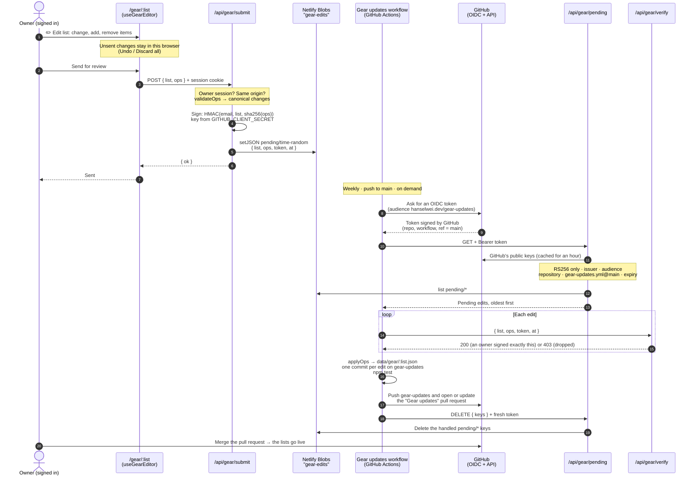
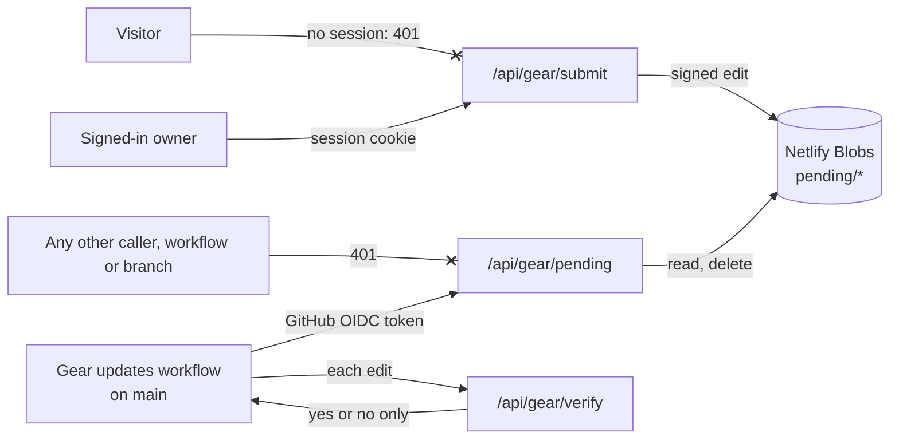

# Editing gear lists

How an edit made on `/gear/<list>` becomes a commit in the **Gear updates** pull request. More detail is in the README, under "Editing gear lists".

**No secret is stored anywhere:**
- The site signs edits with a key derived from the sign-in secret it already has.
- The workflow signs in to the site with a token GitHub mints for that one run.

## Who can do what

